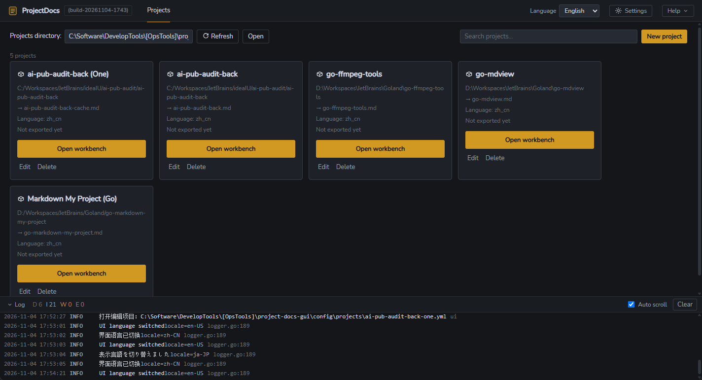
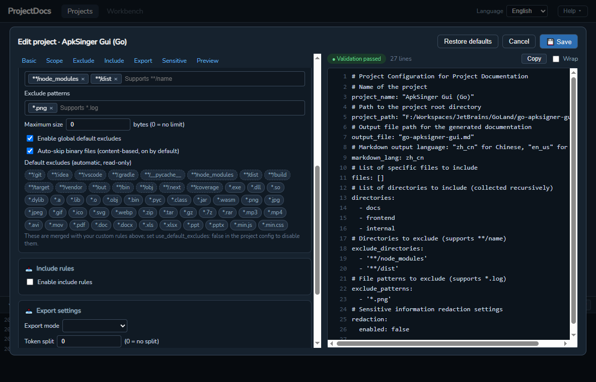
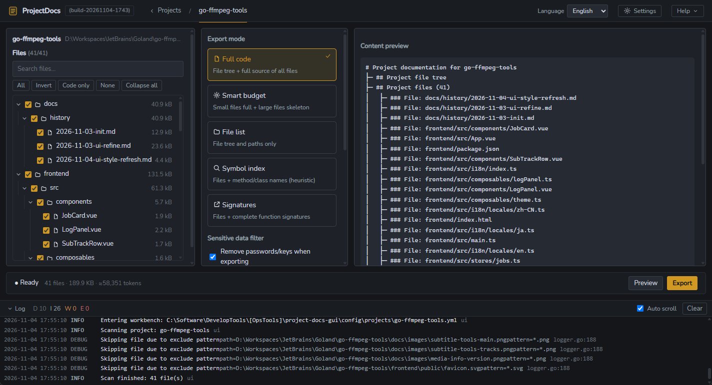
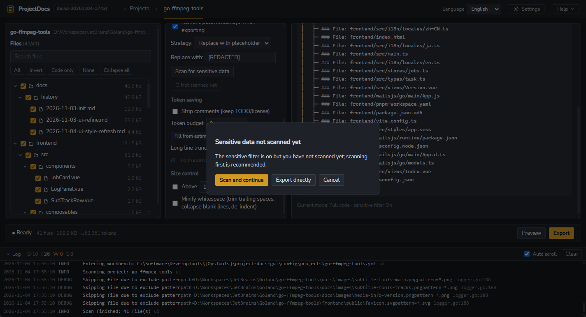

# Project Docs GUI（项目文档聚合工具）

[English](README.md) | 简体中文

     

把本地任意项目聚合成一份干净、结构清晰的 Markdown 文档——完整源码（含文件树）、文件清单或符号索引——可直接粘贴到在线 LLM，用于代码审查、问答或文档整理。

整个流程都在一个桌面应用内完成：选择项目目录，勾选需要的文件，挑选导出模式，一键导出。敏感信息在落盘前自动剥离，Token 用量在导出前提前预估，超大文档可自动拆分。

- 界面语言：**English / 中文 / 日本語**；文档语言：**简体中文 (zh_cn)** 或 **English (en_us)**

## 截图

**项目管理**——管理项目配置，进入工作台：



**项目编辑器**——左侧可视化表单与右侧配置实时镜像；包含范围、排除、包含、导出、敏感信息等标签页：



**工作台**——文件树、导出选项与结果同屏呈现：



**导出模式与敏感数据扫描**——可选 full / files / symbols / signatures；开启脱敏但尚未扫描时，导出前会先提示：



## 功能

| 编号 | 功能 | 说明 |
|------|------|------|
| F1 | 完整代码导出 | 所有勾选文件聚合为一份 Markdown（文件树 + 文件内容），输出与旧版 Rust 工具逐字节一致 |
| F2 | 文件清单导出 | 仅路径与文件树，附带每个文件的语言、行数与大小 |
| F99 | 敏感信息脱敏 | 检测密码 / API Key / Token 等并在导出前替换；应用内扫描，命中结果以掩码抽屉展示 |
| F4 | Token 预估与拆分 | ≈Token 预估（±20%），按文件为最小单位贪心拆分 |
| F3 | 符号与签名导出 | 逐文件符号索引（函数 / 类 / 结构体）及规范化 API 签名，两种轻量结构总览模式 |

导出模式：`full` · `files` · `symbols` · `signatures`。

## 界面结构

两个视图，通过顶部标签页切换：

- **项目管理（Projects）**——项目配置卡片网格；通过 3 步向导创建（含系统原生目录选择对话框），通过可视化编辑器编辑，删除有二次确认。底部停靠应用内日志面板。
- **工作台（Workbench）**——三栏布局，一切同屏：
  - 左：项目信息 + 可折叠文件树（级联勾选、搜索、全选 / 反选 / 仅代码）
  - 中：导出模式卡片、敏感信息脱敏选项（扫描 → 掩码命中抽屉）、Token 拆分控制
  - 右：导出前的内容大纲预览；导出后切换为结果卡片（打开目录 / 复制路径 / 重新导出）
  - 底部状态栏：实时勾选统计（数量 · 大小 · ≈Token）+ 导出操作

## 技术栈

- **后端**：Go 1.22+、Wails v2、`gopkg.in/yaml.v3`、goroutine 工作池、`log/slog` + 滚动日志文件
- **前端**：Vue 3 + TypeScript + Pinia + vue-router + Vite（pnpm）

## 项目结构

```
├── main.go                       # Wails GUI 入口
├── app/app.go                    # 薄 Wails 绑定层（对话框、扫描、导出、YAML 镜像）
├── core/                         # 纯 Go，可独立测试（不 import Wails）
│   ├── config/                   # 项目配置加载/校验/保存 + 带注释模板的 YAML 写出
│   ├── scanner/                  # 文件扫描、排除规则、并行读取
│   ├── generator/                # Markdown 生成（full/files 等模式）+ 文件树
│   ├── symbol/                   # 多语言符号提取（正则 v1）
│   ├── redactor/                 # 敏感信息检测与脱敏引擎
│   ├── token/                    # Token 预估与拆分
│   └── logger/                   # slog 控制台 + 滚动文件
├── config/
│   ├── langs.yml                # 扩展名 → 语言映射
│   ├── exclude_defaults.yml     # 全局默认排除规则（自动合并）
│   └── projects/                # 示例项目配置（*.yml）
├── frontend/
│   ├── src/views/                # ProjectsView / Workbench / FileTree / Wizard / SensitiveDrawer
│   ├── src/components/editor/    # 可视化项目编辑器（表单 + 实时 YAML 预览）
│   ├── src/components/LogPanel   # 应用内日志停靠面板
│   └── src/api/bindings.ts       # 对 window.go.app.App 的手写封装
├── dosc/                         # 设计文档与截图
├── COMMIT.md                     # 待提交变更的提交信息
└── build.ps1                     # 一键构建脚本（Go + pnpm → build/bin/）
```

## 构建

环境要求：**Go 1.22+**、**Node + pnpm**，可选 **Wails v2 CLI**（缺失时脚本会自动安装）。

```powershell
.\build.ps1                # 完整构建 → build/bin/
.\build.ps1 -Clean         # 先清空 build/bin/
.\build.ps1 -SkipInstall   # 跳过 pnpm install
.\build.ps1 -SkipFrontend  # 跳过前端构建（复用 frontend/dist）
.\build.ps1 -Package       # 同时构建 NSIS 安装包（需 makensis）
```

产物位于 `build/bin/`：

```
build/bin/
├── project-docs-gui.exe    # 桌面 GUI（Wails）
└── config/
    ├── langs.yml           # 运行时语言映射（exe 必需）
    ├── exclude_defaults.yml # 默认排除规则（应用于每次扫描）
    └── projects/*.yml      # 示例项目配置
```

## 使用

### GUI

运行 `build\bin\project-docs-gui.exe`。默认项目目录为 `config/projects`（相对于 exe 的工作目录）。

1. **项目管理视图**：点击 `＋ 新建项目配置` 启动向导（用原生对话框选择目录——名称与输出文件名自动填充），或点击 `✏ 编辑` 打开可视化编辑器：左侧表单与右侧 YAML 预览实时同步；保存时执行校验与仅计数的预扫描。
2. **进入工作台 ▸**：在文件树中确认勾选（搜索 / 全选 / 仅代码过滤），选择导出模式，按需执行敏感信息扫描（命中项在掩码抽屉中展示；开启脱敏但未扫描时，导出前会先提示），最后点击 `执行导出`。
3. **结果**：右栏切换为结果卡片——输出路径、字符数、≈Token、耗时——并提供 `打开目录` / `复制路径` / `重新导出`。

进度与错误会内联展示并镜像到日志停靠面板；路径为空或非法时会给出明确错误提示。

## 配置

项目配置（`config/projects/*.yml`）。GUI 编辑器通过 YAML 预览写出与此完全一致的结构（带英文注释模板）：

```yaml
project_name: "My Project"
project_path: "C:/Workspaces/my-project"
output_file: "my_project.md"
markdown_lang: zh_cn            # zh_cn | en_us
files: [cargo.toml]             # 单文件
directories: [src]              # 递归目录
exclude_directories: ["**/444"] # 整目录剪枝；"**/name" 匹配任意层级
exclude_patterns: ["*.log"]     # glob（* / ?）或相对路径前缀匹配
max_file_size: 1048576          # 字节；0/缺省 = 不限制
use_gitignore: true             # 按项目内所有 .gitignore 过滤；false 关闭

# ─── v2 ───
export_mode: full               # full | files | symbols | signatures | custom
redaction:
  enabled: true
  placeholder: "[REDACTED]"
  strategy: placeholder         # placeholder | drop_line
  allowlist: []                 # 已确认的误报："relpath:line:rule"
  custom_patterns: []           # 额外的 RE2 正则
split_tokens: 0                 # >0 启用拆分，如 100000
```

## 敏感信息脱敏（F99）

按设计分为两阶段——绝不静默改写代码：

1. **扫描**：内置规则（密码赋值、AWS 密钥、GitHub PAT、OpenAI 密钥、Slack Token、JWT、PEM 块、数据库连接串、Basic/Bearer 认证）在抽屉中报告掩码后的命中结果——明文绝不进入界面或日志。
2. **确认并导出**：命中项替换为 `[REDACTED]`（或通过 `strategy: drop_line` 整行删除）。PEM 块整体替换。已确认的误报写入 `redaction.allowlist`（键为 `relpath:line:rule`），之后跳过。日志只记录数量与规则名。

内置误报抑制：值中包含 `your_`、`xxx`、`example`、`changeme`、`placeholder`、`dummy`、`test123`、`${...}`、`{{...}}` 或环境变量引用（`process.env`、`os.Getenv`、`import.meta.env`）的会被忽略。

## 开发

```powershell
go test ./core/...          # 单元测试（generator 黄金快照回归、symbol、redactor、token）
wails dev                   # GUI 热重载开发
cd frontend && pnpm dev     # 仅前端开发服务器
```

设计文档（UI 重构、导出模式、编辑器对话框）位于 `dosc/`。

## 备注与限制

- 基于正则的符号提取是启发式的（作为给 LLM 的目录级参考，允许漏报）；规划了 tree-sitter 升级路径。
- Token 预估误差 ±20%，仅用于容量规划。
- `full` 模式在超大项目上可能产生非常大的文件——建议使用 `split_tokens`。
- 扫描路径统一以 `/` 分隔符存储以保证跨平台输出一致；仅 `full` 模式的文件标题保留原生分隔符（与旧版 Rust 输出逐字节一致）。
